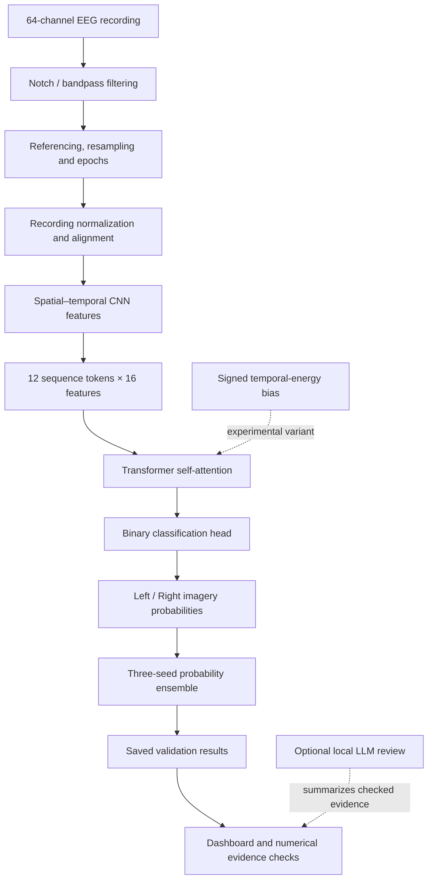

<div align="center">

# 🧠 NeuroTIA
### Lightweight CNN–Transformer for EEG Motor-Imagery Decoding

**Brain–Computer Interfaces • EEG Signal Processing • Hybrid Deep Learning • Evidence-Aware AI**

    

*A reproducibility-focused investigation of compact neural architectures, attention mechanisms, and evidence-grounded reporting for left/right-hand motor-imagery EEG.*

[Explore the Dashboard](https://polashdas040.github.io/NeuroTIA/) · [Original Project](https://github.com/polashdas040/NeuroTIA) · [EEG Dataset](https://physionet.org/content/eegmmidb/1.0.0/)

</div>

---

## 📌 Overview

NeuroTIA studies how **convolutional feature extraction** and **Transformer-based sequence modeling** can work together to classify imagined left- and right-hand movements from 64-channel electroencephalography (EEG). The model is designed to be compact: each network has only **4,920 trainable parameters**.

The research compares three attention strategies under a matched evaluation protocol:

1. **Signed temporal-energy bias** — an experimental attention mechanism based on variation between neighboring latent tokens.
2. **Standard self-attention** — a direct architectural baseline.
3. **Generic energy control** — a comparison that helps isolate the effect of the signed formulation.

A separate, optional **LangGraph + Ollama** workflow reviews saved experiment evidence and requests deterministic checks. The LLM is a *reporting assistant*, **not** an EEG classifier.

> **Research boundary:** Reported performance is from a selected source-validation fold. It must not be interpreted as independent test-set performance, completed cross-validation, or evidence of clinical readiness.

## 🧭 Project at a glance

| Property | Description |
|:--|:--|
| **Task** | Binary classification of left- versus right-hand motor imagery |
| **EEG source** | PhysioNet EEG Motor Movement/Imagery Database (EEGMMIDB v1.0.0) |
| **Signal channels** | 64 EEG channels |
| **Input window** | Four seconds, sampled at 100 Hz after preprocessing |
| **Core architecture** | Spatial–temporal CNN encoder + single compact Transformer |
| **Parameters** | 4,920 per model |
| **Compared variants** | Proposed signed-energy, standard attention, generic energy |
| **Reported ensemble** | Three seeds: 41, 42, 43 |
| **Evaluation scope** | 1,395 imagery trials from 31 participants, one selected validation fold |
| **Additional tooling** | Offline inference, artifact verification, plotting, dashboard, local LLM evidence review |

## 🧠 System architecture

<div align="center">


*Illustration from the original project's architecture assets.*

</div>



### Signal preparation

The source project describes a **50 Hz notch filter**, **4–38 Hz zero-phase bandpass filter**, common-average referencing, resampling to **100 Hz**, four-second epochs, recording normalization, and unlabeled per-recording OAS/Riemannian alignment.

### Hybrid feature learning

The CNN encoder uses spatial/temporal convolutions with depthwise and pointwise operations. It produces **12 tokens with 16 features each**. A single pre-normalized Transformer applies **four attention heads** and a **16–32–16 feed-forward block** before the final classification layer.

### Proposed attention concept

The experimental signed bias measures token-to-token latent changes and allows learned head-wise coefficients to increase or decrease attention toward high-variation tokens. This is a feature-space heuristic; it does **not** directly measure neural connectivity or validated physiological importance.

## 📊 Experimental results

<div align="center">


</div>

The original repository reports three-seed ensemble performance on **1,395 trials from 31 participants** in **one selected source-validation fold**:

| Model | Accuracy | Balanced accuracy | Macro F1 | ROC AUC |
|:--|--:|--:|--:|--:|
| **Signed-energy attention (proposed)** | **89.32%** | 89.32% | 89.32% | 0.9620 |
| Standard self-attention | **89.61%** | 89.60% | 89.60% | 0.9624 |
| Generic energy control | 89.53% | 89.54% | 89.53% | **0.9630** |

**Interpretation:** The proposed variant scored **0.29 percentage points below** standard attention on accuracy in this ensemble comparison. The results demonstrate a competitive compact implementation, but **do not establish an improvement over the baselines**.

### Classification breakdown for the proposed ensemble

| Metric | Left imagery | Right imagery |
|:--|--:|--:|
| Precision | 89.38% | 89.26% |
| Recall | 89.50% | 89.13% |
| F1 score | 89.44% | 89.20% |
| Support | 705 | 690 |

**Confusion matrix** — true labels as rows, predicted labels as columns:

|  | Predicted left | Predicted right |
|:--|--:|--:|
| **Actual left** | 631 | 74 |
| **Actual right** | 75 | 615 |

<div align="center">


</div>

**Evaluation caveats:** Model-selection decisions used the same validation fold. The documented ensemble is not a completed three-fold cross-validation experiment. The published curves show a reference single-seed model, not ensemble training dynamics. The source repository does not include raw EEG or per-trial probability archives for recomputing every metric.

## 🚀 Getting started

### Requirements

- Python **3.12**
- Packages listed in `requirements.txt`
- Node.js **18+** for the optional local dashboard server
- Optional: Ollama for local LLM-assisted evidence review

### 1. Clone the project

```bash
git clone https://github.com/polashdas040/NeuroTIA.git
cd NeuroTIA
python -m venv .venv
```

Activate the environment:

```powershell
# Windows PowerShell
.venv\Scripts\Activate.ps1
```

```bash
# Linux / macOS
source .venv/bin/activate
```

### 2. Install and verify

```bash
python -m pip install -r requirements.txt
python -m model.verify_current
```

The verifier checks included checkpoint hashes and saved aggregate measurements. It is **not** a replacement for inference on original EEG data.

### 3. View the dashboard

```bash
node web_ui/server.js
```

The interactive results dashboard displays included experiment records. Viewing it requires neither raw EEG files nor an LLM API key. A static distribution is also included under `docs/`, suitable for GitHub Pages.

### 4. Try inference on a compatible EEG recording

Get a compatible left/right imagery EDF recording from [PhysioNet EEGMMIDB](https://physionet.org/content/eegmmidb/1.0.0/). For example:

```bash
python -m model.preprocess S073R04.edf --output input.npz
python -m model.predict_current input.npz predictions.npz --complete-recordings
```

The default prediction variant is the proposed ensemble. To compare controls, use `--variant standard` or `--variant generic` in the prediction command. The prepared NPZ input uses the required channel ordering and an `x` array shaped **N × 64 × 400**. The prediction workflow expects complete recordings and should not be represented as validated real-time streaming BCI.

### 5. Optional: inspect experiment evidence with a local LLM

```bash
ollama pull qwen3:1.7b
python -m agent.current_workflow --output runs/evidence_review
```

This workflow retrieves experiment records, requests an LLM-generated verification plan, runs deterministic Python checks, and creates an evidence-oriented summary. **Numerical checks remain authoritative**; generated text can still be incorrect.

## 📁 Repository organization

```text
NeuroTIA/
├── agent/           # LangGraph / Ollama evidence-review components
├── docs/            # Publishable static dashboard
├── figures/         # Architecture and experiment diagrams
├── model/           # Architecture, checkpoints, preprocessing, inference
├── results/         # Measurements, plots and data for the dashboard
├── web_ui/          # Local web dashboard and Node.js server
├── requirements.txt # Python environment dependencies
└── README.md        # Documentation
```

### Reproduce existing figures

```bash
python results/plot_current_results.py
python figures/draw_current_architecture.py
```

The repository provides checkpoint verification, offline inference and figure regeneration. **A complete raw-data training reproduction is not provided** by the public release.

## 📚 Dataset and citations

**Dataset:** [PhysioNet EEG Motor Movement/Imagery Dataset (EEGMMIDB), version 1.0.0](https://physionet.org/content/eegmmidb/1.0.0/) · [DOI: 10.13026/C28G6P](https://doi.org/10.13026/C28G6P).

The original documentation identifies runs **04, 08, and 12** for left/right motor imagery and runs **03, 07, and 11** for executed-movement pretraining. Download the EDF recordings separately; they are not bundled with this repository. Follow the dataset's attribution requirements.

**Related literature**

1. Schalk, G., et al. (2004). BCI2000: A general-purpose brain-computer interface (BCI) system. *IEEE Transactions on Biomedical Engineering, 51*(6), 1034–1043.
2. Song, Y., et al. EEG Conformer: Convolutional Transformer for EEG decoding and visualization. [DOI: 10.1109/TNSRE.2022.3230250](https://doi.org/10.1109/TNSRE.2022.3230250).
3. Zanini, P., et al. Transfer learning: A Riemannian geometry framework with applications to brain–computer interfaces. [DOI: 10.1109/TBME.2017.2742541](https://doi.org/10.1109/TBME.2017.2742541).


</div>
